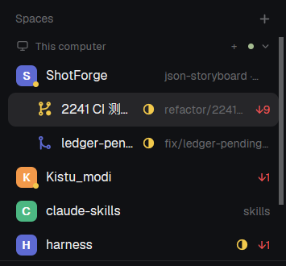

# Herdr Branch Status

A compact Herdr sidebar mod that groups Git worktrees under their repository and shows Git, pull request and agent status.



## Features

- Colored project avatars; a yellow dot indicates uncommitted changes.
- Branch icons for clean, modified, staged, untracked, ahead, behind, diverged, conflict, merging, detached and unknown states.
- Purple merged status, based on a matching merged PR or Git ancestry against the locally recorded `origin/HEAD`.
- GitHub PR icons for draft, open, approved, closed and merged states.
- Working and done indicators from Herdr's reported agent state.
- Machine grouping, worktree nesting, selection, context menus and drag ordering inherited from Herdr's Spaces mod.

## Requirements

- Herdr with its standard `workspace-chrome` and `menu` mods. This mod was cloned from Spaces 0.1.13.
- Git on each machine whose repositories you display.
- Optional: GitHub CLI (`gh`), authenticated with `gh auth login`, for PR status. Remote spaces execute Git and `gh` on the remote machine and use that machine's authentication.

No Node.js packages or build step are required.

## Install

1. Clone or download this repository.
2. Copy `mods/branch-status` into your Herdr home's `mods` directory. The default home is `~/.config/herdr-app`; use `$HERDR_APP_HOME` if configured. Keep the folder name `branch-status`, because icon paths use that name. If that folder already exists, back it up before replacing it.
3. In your chosen `layouts/<name>.json`, find the block displaying `"mod": "spaces"` and change that value to `"mod": "branch-status"`. Keep your other layout settings.
4. Check the installed mod:

   ```sh
   herdr-app check ~/.config/herdr-app/mods/branch-status
   ```

Herdr reloads saved mod and layout files automatically. To uninstall, restore `"mod": "spaces"` and remove the `branch-status` folder.

## Status behavior

Git fallback refresh runs about every 10 seconds while the window is active, with additional refreshes for Git directory events and task transitions. PR queries are limited to once per minute per displayed repository location and current commit. No fetch is performed: ahead/behind and ancestry reflect local Git references.

Conflicts and merge-in-progress take priority over ordinary file changes. File changes take priority over merged and ahead/behind icons. Hover a status to see file counts, branch divergence and PR details.

PR queries use the branch name. An open PR is preferred; closed and merged PRs are accepted only when their head commit matches the current Git HEAD. Query failures show an unknown indicator and the error in the tooltip. The PR list query considers up to 30 matching PRs.

## Access and side effects

The mod reads repository status and Git merge metadata outside its own folder. It runs `git`, `gh` and Herdr Core (`hc`). `gh` contacts GitHub using your existing CLI authentication; this repository contains no credentials. The mod does not commit, push, fetch or merge repositories.

As with the original Spaces mod, it can reorder Herdr spaces to group worktrees, save sidebar UI state, open space menus, and reconnect a replaced machine when you click Connect.

## Origin

Based on the Herdr Spaces mod, cloned through `herdr-app do mod.clone` from version 0.1.13. The `cloned_from` metadata is retained. Branch/PR state interpretation and status icons are included in this repository. See [RECIPE.md](RECIPE.md) for the design brief.
